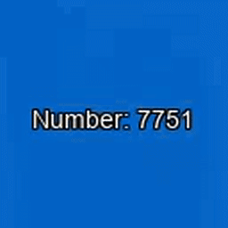

# 🐱 Top 10,000 Cats Video Generator

An automated end-to-end media pipeline powered by **local lightweight AI (YOLOv8 via ONNX Runtime)** that downloads, verifies, sorts by chonkiness (fat cats first!), and renders an epic 15+ hour countdown video featuring thousands of verified cats.

<p align="center">
  
</p>

---

## 📦 Quality Tiers & Previews

All versions feature the complete cat countdown starting with the chonkiest cats, styled with the classic blue countdown cards and smooth cross-dissolve transitions.

| Tier | Size | Bitrate | Description |
|---|---|---|---|
| **Compact** | ~50 MB | ~7 kbps | Ultra-compact build (`cats-50mb.mp4`) |
| **Standard** | ~100 MB | ~14 kbps | Standard balance (`cats-100mb.mp4`) |
| **Full** | ~217 MB | ~32 kbps | Full original master render (`cats-full.mp4`) |

---

## 🚀 Pipeline Architecture

The pipeline runs in 4 stages orchestrated by `run_all.py`:

```
Pexels API ──> [downloader.py] ──> photos/ (Fat cats, Breeds, Colors)
                                      │
                                      ▼
                        [classifier.py] (YOLOv8n ONNX AI)
                                      │
                   ┌──────────────────┴──────────────────┐
                   ▼                                     ▼
         verified/ (Cats Only)                 rejected/ (Non-cats filtered)
                   │
                   ▼ (Sorted: Chonkiness score descending)
         [video_builder.py] ──> clips/ ──> output/10000_cats.mp4
                                                 │
                                                 ▼
                                     [export_qualities.py] ──> Releases
```

1. **Downloader (`downloader.py`)**: Fetches candidates across curated categories:
   - **Fat & Chonky Cats**: *fat cat, chubby cat, chonky cat, round cat, fat orange cat, fluffy loaf*
   - **Breeds**: *British Shorthair, Scottish Fold, Maine Coon, Persian, Ragdoll, Bengal, Sphynx...*
   - **Colors & Patterns**: *Orange tabby, Calico, Tuxedo, Black cat, White cat...*
   - **Cute Poses**: *Cat loaf, Sleeping cat, Cute kitten, Funny cat, Box cat...*
2. **AI Classifier (`classifier.py`)**:
   - Uses local **YOLOv8n ONNX** (Class 15: `cat`) running on CPU via `onnxruntime` (~10ms/image).
   - **100% Cat Guarantee**: Rejects any photo that doesn't clearly contain a real cat (no more random humans, plates, or backgrounds).
   - **Chonkiness Ranking**: Computes an aspect ratio and bounding box coverage score so the fattest, roundest cats appear first.
3. **Video Builder (`video_builder.py`)**:
   - **Classic Blue Screen & Smooth Crossfades**: Generates the iconic blue countdown cards (`Number: {number}`) on `(0, 100, 200)` RGB background. Transitions smoothly via a 1.0s crossfade: 1s fade-in, 2s blue card hold, 1s crossfade dissolve into the verified cat portrait, 2s cat hold, and 1s fade-out (7.0s per item).
   - Produces micro-clips in parallel across all CPU cores and stitches them into `output/10000_cats.mp4`.
4. **Export Qualities (`export_qualities.py`)**:
   - Transcodes master output into Compact (50MB), Standard (100MB), and Full (200MB) release artifacts.

---

## 🛠️ Getting Started

### Prerequisites
- Python 3.9+
- [FFmpeg](https://ffmpeg.org/) installed and available in system `PATH`
- Pexels API Key ([Get a free key here](https://www.pexels.com/api/))

### Installation

1. Install dependencies:
   ```bash
   pip install -r requirements.txt
   ```

2. Set up your API key in `.env`:
   ```bash
   PEXELS_API_KEY="your_api_key_here"
   ```

---

## ⚙️ Running the Pipeline

To run the complete pipeline from scratch:
```bash
python run_all.py
```

To backup existing legacy files and run a fresh 10,000 cat build:
```bash
python run_all.py --clean
```

You can skip stages if intermediate assets already exist:
```bash
python run_all.py --skip-download --skip-classify
```

To transcode release tiers:
```bash
python export_qualities.py --preset all
```
